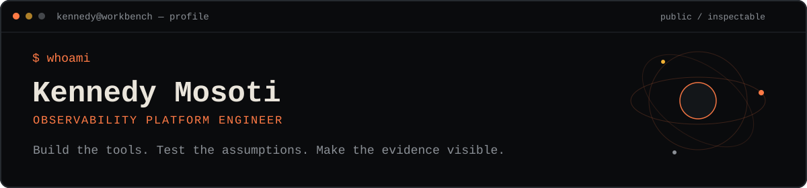

# Kennedy Mosoti

<picture>
  <source media="(max-width: 600px)" srcset="./assets/profile-hero-narrow.svg">
  
</picture>

This profile is a public workbench for the tools and experiments I am building.

The goal is a development ecosystem for quickly experimenting with, testing, and deploying software projects. Some pieces may fit together. Others may stay separate.

Most of the work starts with curiosity. Building it in public is also a way to become a more principled engineer: clearer boundaries, better tests, better evidence, and fewer hidden assumptions.

## Selected work

<!-- profile:begin:projects -->
- [FabricO11y](https://github.com/kmosoti/FabricO11y) — Rust tooling for collecting and querying Linux host, agent, and OpenTelemetry data.
- [Nomos](https://github.com/kmosoti/Nomos) — A Rust Linux agent that reconciles host state with declared configuration and verifies the result.
- [Metron](https://github.com/kmosoti/Metron) — An experimental Rust runtime and harness for reproducible agent experiments and deterministic replay.
- [Splunk Dashboard Studio Python](https://github.com/kmosoti/splunk-dashboard-studio-python) — Python tooling to generate reproducible Splunk Dashboard Studio definitions and check compatibility.
<!-- profile:end:projects -->

## Links

<!-- profile:begin:links -->
- Website: [kennedy.mosoti.dev](https://kennedy.mosoti.dev)
- Website source and build system: [ui-servo](https://github.com/kmosoti/ui-servo)
- [Résumé](./assets/kennedy-mosoti-resume.pdf)
- [Email](mailto:kennedy.rmosoti@gmail.com)
<!-- profile:end:links -->
